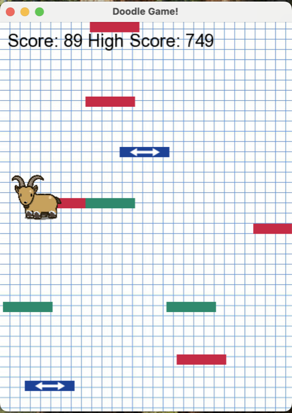

# Jumping Game

A 2D vertical jumping game written in C++ with the SFML graphics library. The player steers a goat that bounces upward across platforms, picks up rockets, and avoids black holes.

This was the final project of the Programming Design course (Fall 2024) at National Taiwan University, built by a team of four. The gameplay is inspired by Doodle Jump, and the project's goal was to apply object-oriented design in C++.



**Demo video:** https://youtu.be/psGe8JH8Jcg

## Gameplay

- Press **Space** on the start screen to begin.
- Use the **Left** and **Right** arrow keys to move. Leaving one side of the window brings the character back on the other side.
- The character jumps automatically each time it lands on a platform.
- The score grows with the height climbed and is shown in the top-left corner with the all-time high score.
- The game ends when the character falls below the window or touches a black hole.

### Platforms

| Type | Behavior | Share of platforms |
|---|---|---|
| Regular | Stays in place | 50% |
| Moving | Slides left and right and reverses at the window edges | 30% |
| One-time | Disappears after one bounce | 20% |

### Items

| Item | Effect |
|---|---|
| Rocket | Launches the character upward and makes it immune to black holes for 300 frames (5 seconds at 60 FPS) |
| Black hole | Ends the game on contact |

## Design

### Class hierarchy

```
Platform (abstract)                GameObject (abstract)
├── RegularPlatform                ├── Rocket
├── MovingPlatform                 └── BlackHole
└── OneTimePlatform
```

- **`Platform`** defines the shared interface: `update()` scrolls the platform, `update_x()` moves it sideways, `draw()` renders it, and `checkCollision()` detects a landing and sets the bounce velocity.
- **`GameObject`** defines the same kind of interface for items.
- The game loop holds platforms as `std::vector<std::unique_ptr<Platform>>` and calls them through the base class, so each type supplies its own behavior through virtual functions.

### C++ features used

| Feature | Use |
|---|---|
| Abstract classes and inheritance | Shared interfaces for platforms and items |
| Polymorphism (`virtual`, `override`) | One loop updates, draws, and collision-checks every platform type |
| Smart pointers (`std::unique_ptr`) | Ownership of platforms and items, with no manual `delete` |
| File I/O (`ifstream`, `ofstream`) | The high score is stored in `sources/highscore.txt` |
| Random generation | Platform positions and types, and item spawns |

### Platform recycling

There are always 10 platforms. When the character rises above a fixed height, the scene scrolls down instead of the character moving up. A platform that scrolls past the bottom edge is replaced with a new one at the top, with a random horizontal position and a random type. Each replacement also has a chance to spawn a rocket (1 in 20) or a black hole (1 in 7) if none is on screen.

## Build and run

SFML 2.x is required. On macOS it can be installed with Homebrew (`brew install sfml@2`).

Run these commands inside `src/`:

```bash
g++ main.cpp -std=c++17 \
    -I/opt/homebrew/opt/sfml/include \
    -L/opt/homebrew/opt/sfml/lib \
    -lsfml-graphics -lsfml-window -lsfml-system \
    -o prog
./prog
```

### Font

The font file is not included in this repository because of its license. Before running the game, copy `arial.ttf` into `src/sources/`:

| System | Location of the font |
|---|---|
| macOS | `/System/Library/Fonts/Supplemental/Arial.ttf` |
| Windows | `C:\Windows\Fonts\arial.ttf` |

On macOS:

```bash
cp /System/Library/Fonts/Supplemental/Arial.ttf sources/arial.ttf
```

Any other TrueType font also works if it is saved as `sources/arial.ttf`. Without the file the game still runs, but the score is not displayed.

### Notes

- Compile `main.cpp` only. The classes are fully defined in `Platform.h` and `GameObject.h`.
- Run the program from `src/`, because images, the font, and the high score are loaded from the relative path `sources/`.
- The build was checked with SFML 2.6.2 on macOS (Apple Silicon).

## Repository layout

| Path | Contents |
|---|---|
| `src/main.cpp` | Game loop, input, scoring, rendering |
| `src/Platform.h` | Platform classes |
| `src/GameObject.h` | Rocket and black hole classes |
| `src/sources/` | Images and high score file |
| `demo_slides.pdf` | Demo slides |

## Acknowledgements

The gameplay is inspired by Doodle Jump, created by Igor and Marko Pusenjak.
